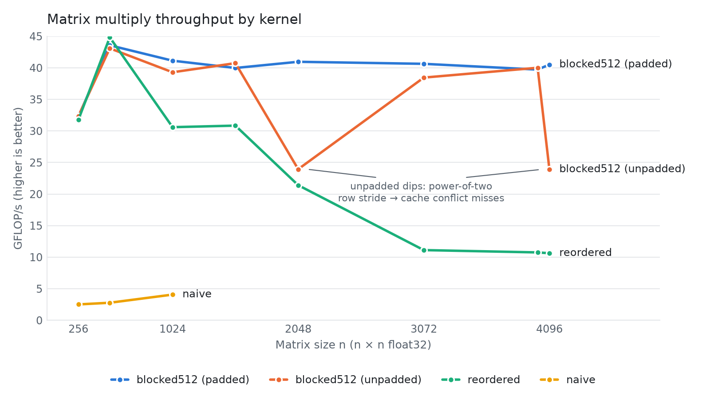

# matmul-bench

Cache-aware C++ matrix multiplication kernels, benchmarked and tested against NumPy.

Three single-threaded float32 kernels, from the textbook triple loop to a
cache-blocked version, plus row padding that removes a 1.7x slowdown at
power-of-two sizes. Every kernel is checked against NumPy, and every result
below comes from a logged, reproducible run.

## Results

<picture>
  <source media="(prefers-color-scheme: dark)" srcset="results/gflops_vs_n_dark.png">
  
</picture>

- **Loop order alone is worth ×7.5.** Swapping the inner two loops (i-j-k to
  i-k-j) makes the inner loop walk memory contiguously, which most likely also
  lets the compiler vectorise it: 4.1 to 30.6 GFLOP/s at n=1024.
- **Blocking keeps performance flat.** `reordered` falls from 45 to 11 GFLOP/s
  as the matrices outgrow the cache. `blocked512` works on 512 x 512 tiles that
  stay in cache while they are reused, and holds about 40 GFLOP/s from n=512 to
  n=4096: ×3.8 faster than `reordered` at n=4096.
- **Row padding fixes a power-of-two slowdown.** Without padding, `blocked512`
  drops to 24 GFLOP/s at exactly n=2048 and n=4096, while n=4000 runs at full
  speed. When rows are an exact multiple of 4 KB apart, the rows of a tile map
  to the same cache sets and evict each other. Padding each row by one cache
  line restores about 40 GFLOP/s (×1.7), at no cost elsewhere.
- **The best tile size depends on the memory layout.** Without padding, 256 was
  best; with padding, 512 is. The full sweep is in [Run 8](results/results.md).

**GFLOP/s by matrix size** (higher is better)

| n | naive | reordered | blocked512 (unpadded) | blocked512 (padded) |
|---|---|---|---|---|
| 256 | 2.52 | 31.77 | 32.33 | 32.27 |
| 512 | 2.78 | 44.83 | 43.09 | 43.57 |
| 1024 | 4.08 | 30.60 | 39.30 | 41.13 |
| 2048 | | 21.41 | 23.94 | 40.96 |
| 3072 | | 11.12 | 38.45 | 40.63 |
| 4000 | | 10.76 | 40.01 | 39.72 |
| 4096 | | 10.63 | 23.90 | 40.52 |

`naive` and `reordered` use the padded build. Without padding, `naive` at n=1024
falls to 0.86 GFLOP/s: its column walk hits the same conflict misses.

**Method.** Intel Core Ultra 7 165H, g++ 16.2 `-O3 -march=native`, Windows 11,
one thread. Each figure is the median of 3 timed runs after a warm-up, with the
kernels interleaved at each size so drift affects them equally. Raw data:
[`results/readme_sweep.csv`](results/readme_sweep.csv). How the conclusions were
reached, including one that was later corrected:
[`results/results.md`](results/results.md).

**Limitations.** The cache explanations are inferred from timings; cache misses
have not yet been measured with a profiler, and auto-vectorisation has not been
confirmed from compiler reports. The kernels are single-threaded, and there is
no comparison with an optimised BLAS yet.

## Kernels

| Kernel | Idea |
|--------|------|
| `naive` | Textbook i-j-k triple loop; the correctness baseline |
| `reordered` | Same arithmetic in i-k-j order, so the inner loop walks memory contiguously |
| `blocked` | Works on cache-sized tiles that are reused while they are still in cache; registered as `blocked32` to `blocked1024` |
| Row padding | Rows padded so the stride is never a multiple of 4 KB, avoiding cache conflict misses at power-of-two sizes (`MATMUL_PAD_ROWS`, on by default) |

## Build and test

Requires CMake 3.20+, a C++17 compiler and Python 3.10+.

```bash
cmake -S . -B build -G Ninja -DMATMUL_NATIVE=ON
cmake --build build
ctest --test-dir build --output-on-failure

python -m venv .venv
source .venv/Scripts/activate     # Git Bash on Windows; .venv/bin/activate on Linux/macOS
pip install -r python/requirements.txt
pytest -v
```

Build options:

| Option | Default | Effect |
|---|---|---|
| `MATMUL_NATIVE` | OFF | Tune for this machine's CPU (`-march=native`). Leave off when numbers must be comparable across machines. |
| `MATMUL_PAD_ROWS` | ON | Pad each row so its stride is never a multiple of 4 KB. Turn off to reproduce the power-of-two slowdown. |
| `MATMUL_BUILD_TESTS` | ON | Build the GoogleTest suite. |

## Benchmark

```bash
build/matmul_bench list
build/matmul_bench bench blocked512 2048 5
# -> kernel,n,repeats,median_ms,gflops
```

To reproduce the chart, build an unpadded copy alongside the default one, then
run the sweep (a few minutes) and the plot:

```bash
cmake -S . -B build-nopad -G Ninja -DMATMUL_NATIVE=ON -DMATMUL_PAD_ROWS=OFF
cmake --build build-nopad
python python/sweep.py     # writes results/readme_sweep.csv
python python/plot.py      # writes results/gflops_vs_n_{light,dark}.png
```

## Layout

```
include/matmul/   Matrix (row-major, padded rows) and kernel declarations
src/              Matrix implementation and the kernels
bench/            matmul_bench command-line tool
tests/            GoogleTest suite, run against every registered kernel
python/           pytest harness comparing every kernel with NumPy; sweep and plot scripts
results/          benchmark log, chart data and chart images
```

## Licence

MIT
